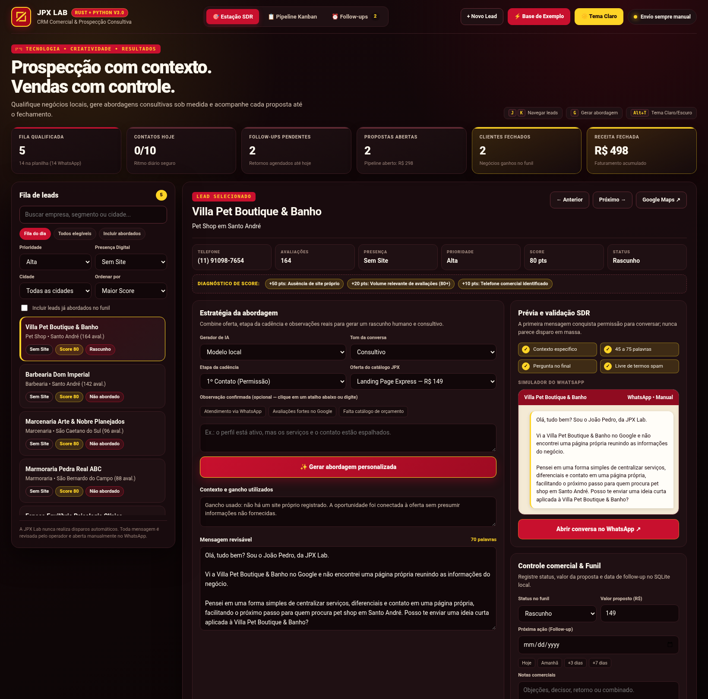
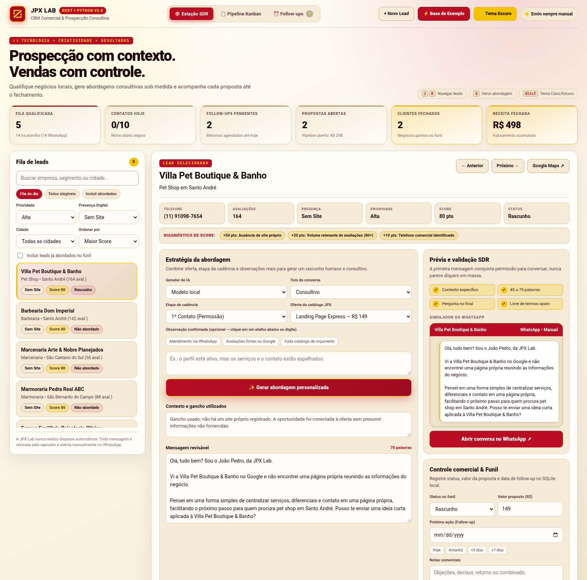
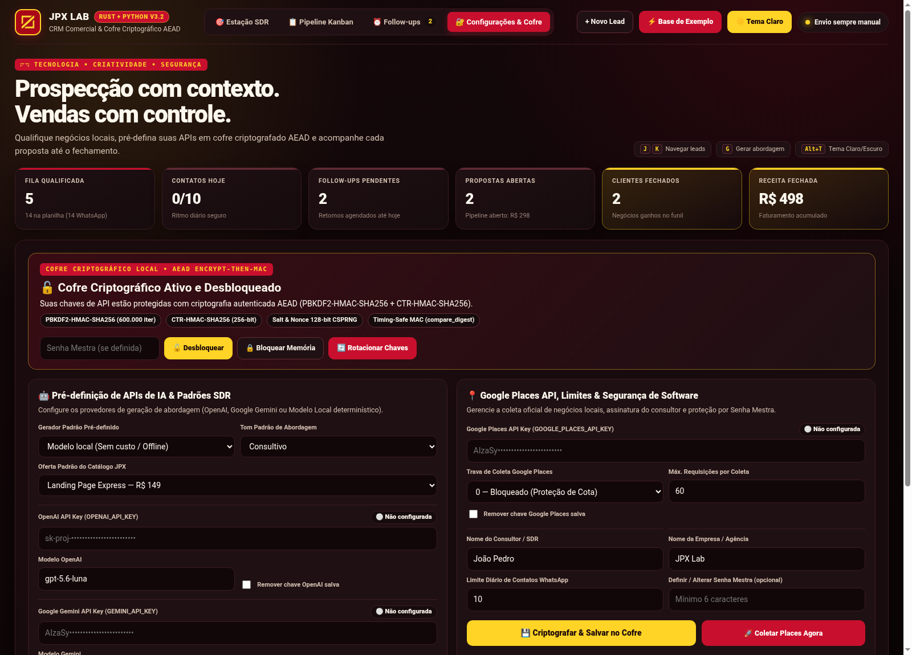
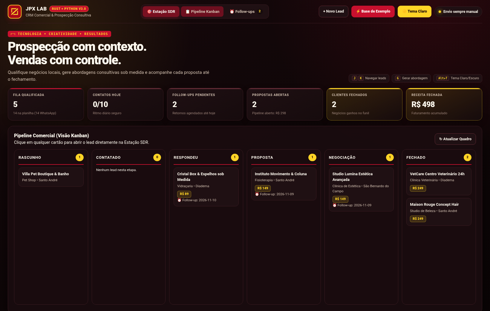
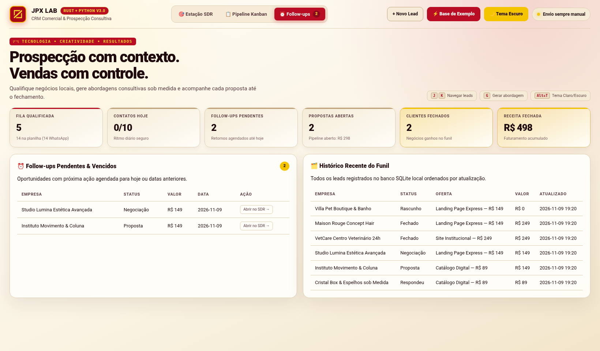
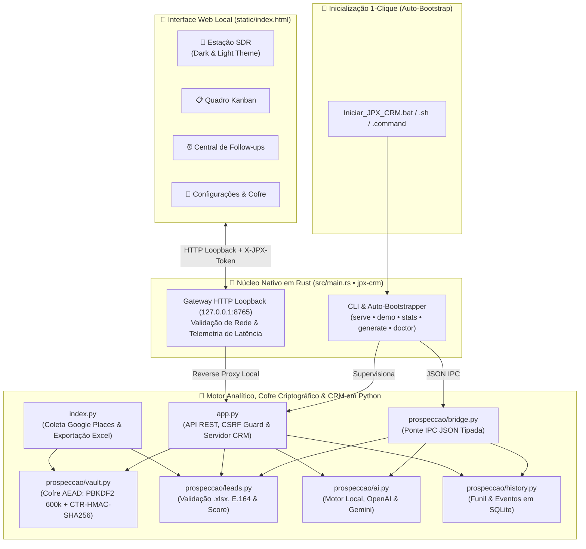

<div align="center">


# JPX Lab • Automation Leads & CRM v3.2

**Onde a velocidade nativa do Rust encontra a inteligência de dados do Python e um Cofre Criptográfico AEAD para transformar negócios locais em oportunidades comerciais reais.**

[](#arquitetura-híbrida-rust--python)
[](#arquitetura-híbrida-rust--python)
[](#segurança-por-design--cofre-criptográfico-aead)
[](#galeria-da-plataforma-temas-escuro--claro)
[](#filosofia-anti-spam--uso-responsável)
[](LICENSE)

*Abertura 1-Clique • Cofre de APIs Criptografado • Coleta Google Places • Scoring Transparente • Estação SDR com IA • Pipeline Kanban • Temas Claro & Escuro*

</div>

---

## ⚡ Por que o Automation Leads existe?

A maioria das ferramentas de prospecção falha por dois motivos extremos: ou são **planilhas frias** onde o vendedor perde horas copiando telefones e esquecendo follow-ups, ou são **robôs de disparo em massa** que destroem a reputação da marca no WhatsApp.

O **JPX Lab Automation Leads & CRM v3.2** foi projetado por **João Pedro de Moura Lima** como uma **Estação de Trabalho SDR Local (Human-in-the-Loop)**:

1. **Abre com 1 clique após clonar**: basta clicar em `Iniciar_JPX_CRM.bat` (Windows), `Iniciar_JPX_CRM.sh` (Linux) ou `Iniciar_JPX_CRM.command` (macOS) — ou no binário nativo compilado (`jpx-crm`). O sistema prepara o ambiente automaticamente, cria a base demonstrativa se não houver planilha `.xlsx` e abre o navegador na hora.
2. **Cofre Criptográfico de APIs na própria interface**: pré-defina suas chaves **OpenAI**, **Google Gemini** e **Google Places** diretamente na aba **🔐 Configurações & Cofre**, protegidas em disco com criptografia autenticada **AEAD (`PBKDF2-HMAC-SHA256` 600.000 iterações + `CTR-HMAC-SHA256` + `Encrypt-then-MAC`)**, bloqueio em memória e rotação de chaves.
3. **Encontra quem realmente precisa de você**: coleta negócios locais pela API oficial do Google Places, filtra por volume de avaliações e identifica empresas **sem site próprio** ou dependentes apenas de **redes sociais/agregadores de links**.
4. **Explica o porquê de cada oportunidade**: calcula um **Score Comercial (0 a 80 pts)** com diagnóstico transparente na tela.
5. **Escreve como um consultor humano, nunca como um robô**: gera abordagens sob medida para **14 ofertas de entrada** e **4 etapas de cadência** (1º Contato, Follow-up 1, Follow-up 2 e Proposta) usando **Modelo Local determinístico**, **OpenAI** ou **Google Gemini**.
6. **Impõe controle e ética comercial**: valida a qualidade do texto em tempo real, limita o volume diário de contatos e **jamais envia mensagens sozinho** — você revisa no simulador do WhatsApp e abre a conversa manualmente.

---

## 🖼️ Galeria da Plataforma (Temas Escuro & Claro)

A interface v3.2 foi inteiramente desenhada com a identidade cromática da **JPX Lab** — **Vermelho Carmesim (`#C8102E`)**, **Creme Editorial (`#FAF3E3`)** e **Amarelo Geométrico (`#FFD426`)** — contando com alternância instantânea entre **Tema Escuro (*Rubi Noturno*)** e **Tema Claro (*Creme Solar*)** pelo botão superior ou pelo atalho `Alt + T`.

### 🌙 1. Estação SDR — Tema Escuro (*Rubi Noturno*)
> Visão principal de trabalho: fila filtrável à esquerda, diagnóstico de score, gerador de abordagem por etapa da cadência, validador de qualidade de copy, simulador do WhatsApp e controle de funil à direita.



### ☀️ 2. Estação SDR — Tema Claro (*Creme Solar*)
> Construído sobre tons de creme quente (`#FAF3E3` / `#FFFDF8`), bordas areia e tipografia expresso-bordô para máxima legibilidade em ambientes iluminados.



### 🔐 3. Configurações de APIs & Cofre Criptográfico AEAD
> Área dedicada para pré-definir chaves de API (OpenAI, Google Gemini e Google Places), escolher provedor/tom/oferta padrão, proteger com Senha Mestra, bloquear credenciais na memória RAM, rotacionar chaves criptográficas e disparar coleta Google Places sob demanda.



### 📋 4. Pipeline Comercial — Visão Kanban Interativa
> Acompanhe visualmente cada negócio pelas etapas `Rascunho`, `Contatado`, `Respondeu`, `Proposta`, `Negociação` e `Fechado`, com ticket proposto e data de retorno. Clique em qualquer cartão para abrir o lead na Estação SDR.



### ⏰ 5. Central de Follow-ups & Histórico SQLite
> Nunca perca o timing de uma negociação: visualize todos os retornos agendados para hoje (ou vencidos) e o histórico completo de movimentações do funil.



---

## 🦀🐍 Arquitetura Híbrida: Rust + Python + Cofre AEAD

Na versão 3.2, o projeto opera como uma **aplicação híbrida otimizada**: um binário nativo em **Rust (`jpx-crm`)** — compilado com otimização máxima (`opt-level = 3`, `LTO = true`) e zero dependências externas para compilação instantânea e superfície de ataque zero — que prepara o ambiente automaticamente, abre o navegador e consome os módulos de dados, criptografia e IA em **Python (`prospeccao/*`)** via IPC JSON e Gateway HTTP local.



---

## 🚀 Como Usar (Abertura em 1 Clique após Clonar)

O projeto foi preparado para **subir sem erros logo após o `git clone`**, mesmo quando ainda não existem planilhas `.xlsx`, banco `.db` ou ambiente `.venv`:

```bash
git clone https://github.com/jotape2709/Automation-leads.git
cd Automation-leads
```

### Opção A — Clicar no Executável / Lançador (1 Clique)

Basta dar duplo clique no lançador correspondente ao seu sistema operacional na raiz do projeto:

- **Windows**: duplo clique em **`Iniciar_JPX_CRM.bat`**
- **Linux**: duplo clique ou `./Iniciar_JPX_CRM.sh`
- **macOS**: duplo clique em **`Iniciar_JPX_CRM.command`**

O que o lançador faz automaticamente:
1. Verifica se já existe o binário nativo otimizado em Rust (`target/release/jpx-crm`) ou compila em segundos se o `cargo` estiver presente;
2. Cria o ambiente virtual `.venv` e instala `pandas`, `openpyxl` e `requests` automaticamente na primeira execução;
3. Semeia uma base demonstrativa realista (14 leads do ABC Paulista + pipeline inicial) caso `Leads_ABC_Paulista.xlsx` ainda não exista;
4. Inicia o servidor em `http://127.0.0.1:8765` e **abre o navegador automaticamente**.

### Opção B — Executar via Motor Híbrido Rust (`cargo`)

```bash
# Compila em modo release super-otimizado (LTO + opt-level 3)
cargo build --release

# Inicia o Gateway Rust + Painel Web em http://127.0.0.1:8765 e abre o navegador
./target/release/jpx-crm

# Ou execute subcomandos específicos da CLI em Rust:
cargo run -- demo                                             # Popula 14 leads do ABC Paulista + funil de exemplo
cargo run -- stats                                            # Exibe painel de métricas do CRM direto no terminal
cargo run -- generate "Barbearia Dom Imperial" "Barbearia"    # Gera pitch consultivo no terminal via IPC Python
cargo run -- doctor                                           # Audita segurança do repositório e roda todos os testes
```

### Opção C — Executar diretamente via Python

```bash
python app.py        # Prepara dependências se necessário, sobe em http://127.0.0.1:8765 e abre o navegador
python index.py      # Coleta novos leads reais via Google Places API (lê chave do Cofre AEAD ou do .env)
```

---

## 🎯 Exemplo Real: Como a Qualificação e a Abordagem Funcionam

Imagine que o coletor encontrou o seguinte negócio em Santo André:

| Campo | Valor Coletado | Impacto no Score |
| :--- | :--- | :--- |
| **Empresa** | `Villa Pet Boutique & Banho` | Identificação nominal no gancho |
| **Segmento / Cidade** | `Pet Shop` • `Santo André, SP` | Contextualização regional |
| **Presença Digital** | `Sem Site` (apenas listagem no Google) | **+50 pontos** (alta dor de conversão) |
| **Volume de Avaliações** | `164 avaliações` no Google | **+20 pontos** (demanda comprovada, ≥ 80 aval.) |
| **Telefone Comercial** | `(11) 91098-7654` → E.164 `5511910987654` | **+10 pontos** (celular válido para WhatsApp) |
| **Resultado Final** | **Prioridade Alta** | **Score: 80 pontos** |

### 💬 Abordagens Geradas por Etapa da Cadência (Oferta: *Landing Page Express — R$ 149*)

> **1º Contato (Conquista de Permissão — Sem mencionar preço):**
> ```text
> Olá, tudo bem? Sou o João Pedro, da JPX Lab.
>
> Vi a Villa Pet Boutique & Banho no Google e não encontrei uma página própria reunindo as informações do negócio.
>
> Pensei em uma forma simples de centralizar serviços, diferenciais e contato em uma página própria, facilitando o próximo passo para quem procura pet shop em Santo André. Posso te enviar uma ideia curta aplicada à Villa Pet Boutique & Banho?
> ```

> **Follow-up 1 (48h depois — Foco em valor visual):**
> ```text
> Oi, tudo bem? Aqui é o João Pedro, da JPX Lab, retomando meu contato anterior sobre a Villa Pet Boutique & Banho.
>
> Sei que a rotina de pet shop em Santo André é corrida, então deixei separado um rascunho objetivo mostrando como centralizar serviços, diferenciais e contato em uma página própria de forma prática.
>
> Faz sentido eu te enviar esse exemplo em uma imagem rápida por aqui?
> ```

O **Validador SDR em tempo real** confere automaticamente 4 critérios antes de liberar o clique para o WhatsApp:
- ✅ **Contexto específico**: cita o nome da empresa ou a cidade;
- ✅ **Extensão ideal**: entre **45 e 75 palavras** (leitura rápida no celular);
- ✅ **Pergunta aberta no final**: convida à resposta sem forçar venda;
- ✅ **Livre de termos de spam**: bloqueia clichês como *"gostaria de oferecer"*, *"sem compromisso"*, *"promoção imperdível"* ou *"garantimos"*.

---

## 💼 Catálogo Integrado de 14 Ofertas (JPX Lab)

Cada oferta possui um ângulo consultivo calibrado em [`prospeccao/ai.py`](prospeccao/ai.py) e preenche automaticamente o valor sugerido no funil comercial:

| Oferta | Ticket Sugerido | Dor / Oportunidade que Resolve |
| :--- | :---: | :--- |
| **Diagnóstico Digital** | R$ 49 | Identificar prioridades simples para melhorar a jornada entre descoberta e contato |
| **Cartão Digital** | R$ 49 | Reunir apresentação, serviços e contatos em um material fácil de compartilhar |
| **Página de Links** | R$ 59 | Organizar os principais caminhos de contato em uma página objetiva |
| **Google Profissional** | R$ 69 | Deixar serviços e informações mais claros para quem encontra o negócio no Google |
| **Kit Social Inicial** | R$ 69 | Dar consistência às primeiras peças de comunicação nas redes |
| **Logo Essencial** | R$ 79 | Construir uma apresentação visual mais reconhecível e consistente |
| **Planilha Essencial** | R$ 79 | Organizar um controle operacional que hoje pode estar disperso |
| **Catálogo Digital** | R$ 89 | Organizar produtos ou serviços para consulta e pedido pelo WhatsApp |
| **E-mail Profissional** | R$ 89 | Fortalecer a apresentação da empresa nos contatos comerciais |
| **Landing Page Express** | R$ 149 | Centralizar serviços, diferenciais e contato em uma página própria de conversão |
| **Dashboard Express** | R$ 149 | Transformar dados operacionais em indicadores fáceis de acompanhar |
| **Automação Essencial** | R$ 149 | Reduzir uma tarefa repetitiva sem complicar a rotina da equipe |
| **Site Institucional** | R$ 249 | Estruturar uma presença própria com informações e contato bem organizados |
| **Presença Completa** | R$ 249 | Alinhar identidade, página, Google e comunicação em uma presença consistente |

---

## ⌨️ Usabilidade & Atalhos da Plataforma

| Atalho / Ação | Função na Interface |
| :---: | :--- |
| `Alt + T` | Alterna instantaneamente entre o **Tema Escuro (*Rubi Noturno*)** e o **Tema Claro (*Creme Solar*)** |
| `J` / `Próximo →` | Avança para o próximo lead da fila qualificada |
| `K` / `← Anterior` | Retorna ao lead anterior da fila |
| `G` | Gera uma nova abordagem personalizada para o lead selecionado |
| `🔐 Configurações & Cofre` | Abre a área de pré-definição de APIs, criptografia AEAD, bloqueio de memória e coleta Places |
| `⚡ Base de Exemplo` | Cria/recarrega com 1 clique 14 negócios simulados do ABC Paulista e popula o funil |
| `+ Novo Lead` | Abre o modal para cadastrar manualmente um negócio na planilha `.xlsx` com cálculo automático de Score |
| `?theme=light` / `?view=settings` | Suporte a *deep-linking* por parâmetros de URL (`sdr`, `kanban`, `followups`, `settings`) |

---

## 🔒 Segurança por Design & Cofre Criptográfico AEAD

Este projeto implementa defesa em profundidade (*Defense-in-Depth*) documentada em [SECURITY.md](SECURITY.md) e [`prospeccao/vault.py`](prospeccao/vault.py):

1. **Cofre Criptográfico Autenticado (`JPXVAULT1` AEAD Encrypt-then-MAC)**:
   - **Derivação de chave (KDF)**: `PBKDF2-HMAC-SHA256` com **600.000 iterações** (recomendação OWASP) e salt CSPRNG de 128 bits, combinando chave de entropia local da máquina (`.vault.key` com permissão `0600`) + Senha Mestra opcional do operador;
   - **Separação criptográfica de subchaves**: derivação independente de `K_enc` (256 bits) e `K_mac` (256 bits) via `HMAC-SHA256`;
   - **Cifra de fluxo CTR + Autenticação MAC**: cifragem em modo contador com nonce CSPRNG de 128 bits seguida de tag `HMAC-SHA256` verificada em **tempo constante** (`hmac.compare_digest`);
   - **Mascaramento e Bloqueio em Memória**: chaves salvas nunca retornam em texto puro para a interface (`sk-p••••••••1234`), podem ser removidas da memória RAM com 1 clique (**🔒 Bloquear Memória**) e re-criptografadas com novo salt/nonce (**🔄 Rotacionar Chaves**).
2. **Proteção de Sessão, CSRF e Rate Limiting**:
   - Token de sessão CSPRNG (`X-JPX-Token`) validado em tempo constante nas rotas administrativas e limitador de taxa por janela deslizante (`LimitadorTaxa`) contra força bruta.
3. **Isolamento em Loopback (`127.0.0.1`) & Cabeçalhos de Segurança**:
   - Tanto o gateway Rust quanto o servidor Python rejeitam conexões externas, validam `Host` e `Origin` e aplicam `Content-Security-Policy`, `X-Frame-Options: DENY`, `X-Content-Type-Options: nosniff` e `Cache-Control: no-store`.
4. **Prevenção contra XSS, Injeção de Fórmulas e Zip Bomb**:
   - A interface web usa exclusivamente criação segura de nós DOM (`createElement` / `textContent`), sem `innerHTML` ou handlers inline; células exportadas para `.xlsx` têm prefixos de fórmula (`=`, `+`, `-`, `@`) neutralizados; e [`prospeccao/leads.py`](prospeccao/leads.py) bloqueia arquivos `.xlsx` com taxa de compressão suspeita antes da leitura.

### Rodando a suíte de testes e auditoria de segurança

```bash
# Via Rust Doctor (roda scanner de segredos + 18 testes unitários Python)
./target/release/jpx-crm doctor

# Testes unitários do motor Rust
cargo test

# Testes funcionais, Cofre AEAD, CRM e segurança em Python
python -m unittest discover -s tests -v
python scripts/security_scan.py
```

---

## 📁 Estrutura do Projeto

```text
Automation-leads/
├── Iniciar_JPX_CRM.bat        # Executável 1-clique para Windows (auto-bootstrap + abre navegador)
├── Iniciar_JPX_CRM.sh         # Executável 1-clique para Linux
├── Iniciar_JPX_CRM.command    # Executável 1-clique para macOS
├── Cargo.toml                 # Manifesto do motor nativo em Rust (perfil release otimizado com LTO)
├── src/
│   └── main.rs                # CLI, Auto-Bootstrapper, Gateway HTTP Loopback e ponte IPC em Rust
├── app.py                     # Servidor HTTP, API REST, Cofre AEAD e auto-seed inicial (Python)
├── index.py                   # Coleta Google Places API integrada ao Cofre AEAD e exportação Excel
├── prospeccao/
│   ├── vault.py               # Cofre Criptográfico AEAD (PBKDF2 600k + CTR-HMAC-SHA256 + Rate Limiter)
│   ├── ai.py                  # Geração assistida por etapa da cadência (Local, OpenAI, Gemini)
│   ├── bridge.py              # Ponte IPC JSON consumida pelo binário Rust
│   ├── config.py              # Carregador seguro de variáveis .env
│   ├── demo.py                # Gerador de base demonstrativa do ABC Paulista e seed do funil
│   ├── history.py             # Persistência SQLite, métricas de receita e linha do tempo de eventos
│   ├── http.py                # Cliente HTTP seguro com redação automática de segredos
│   └── leads.py               # Validação anti-zipbomb de .xlsx, E.164, filtros e diagnóstico de Score
├── static/
│   ├── index.html             # Estação SDR, Kanban, Follow-ups e Cofre AEAD (Temas Escuro & Claro)
│   └── logo.png               # Logo geométrico oficial da JPX Lab
├── docs/assets/               # Capturas de tela reais da plataforma (SDR Dark/Light, Cofre, Kanban, Follow-ups)
├── scripts/
│   └── security_scan.py       # Auditoria pré-commit contra segredos e arquivos sensíveis (.xlsx, .db, .enc)
└── tests/                     # Suíte de 18 testes automatizados (Cofre AEAD, CRM, API MVP e Segurança)
```

---

## 🤝 Filosofia Anti-Spam & Uso Responsável

O **Automation Leads** foi criado para **prospecção consultiva, individual e ética**. Não importe listas compradas, não utilize automação de navegador para disparos não solicitados, respeite imediatamente qualquer pedido de não contato (utilizando o botão **🚫 Bloquear** no painel) e revise cada mensagem com atenção genuína ao negócio local.

---

<div align="center">

Desenvolvido por **João Pedro de Moura Lima** • **JPX Lab**  
*Tecnologia. Criatividade. Resultados.*

</div>

